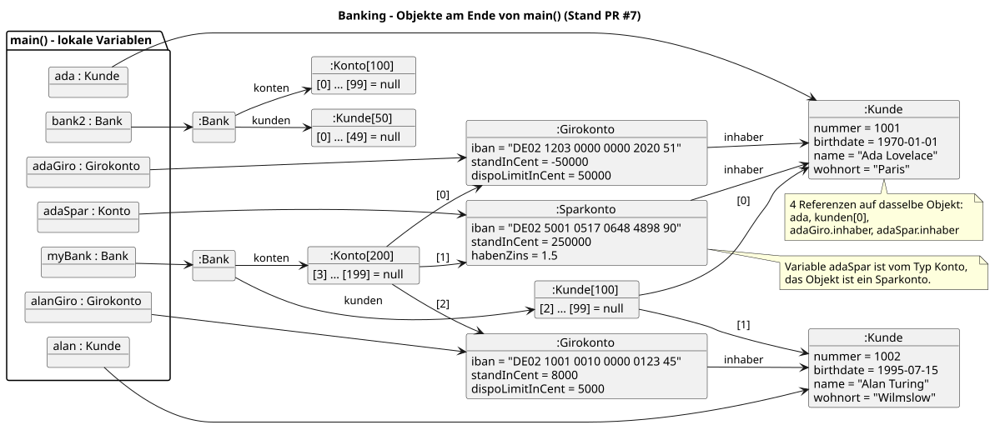

# Java-OO-Einsteigerseminar

Willkommen! Dieses Repository enthält die Beispiele und Lösungen, die wir im
Seminar gemeinsam entwickelt haben. Jeder Schritt ist als eigener Pull Request
nachvollziehbar.

## Was ist drin?

| Ordner | Inhalt |
|--------|--------|
| [`my-first-java`](my-first-java) | Erste Schritte: Wetterstation (Methoden, Arrays), Büro (Stift und Tisch) und Fahrradverleih (Klassen, Objekte, Referenzen, `toString()`, Kapselung) |
| [`my-banking`](my-banking) | Das Banking-Beispiel ohne Build-Werkzeug: Kunden, Konten, Bank – bis zur Vererbung mit Giro- und Sparkonto |
| [`my-banking-maven`](my-banking-maven) | Derselbe Stand als Maven-Projekt (JDK 25) – **damit arbeiten wir weiter** |
| [`docs`](docs) | Klassen- und Objektdiagramme zu jedem Stand |

Zum Starten `my-banking-maven` in der IDE als Maven-Projekt öffnen und
`de.schulung.banking.start.Main` ausführen.

## Die Schritte im Seminar

Jeder Pull Request ist ein Schritt im Seminar. Die Diagramme dazu zeigen den
Stand nach dem jeweiligen Schritt.

| PR | Zweck | Diagramm |
|----|-------|----------|
| [#1](https://github.com/atvantage-academy/training-2026-08-24-java-oop/pull/1) | Fahrradverleih: erste eigene Klassen mit Feldern und Beziehungen | [`fahrradverleih_1`](docs/fahrradverleih_1.svg) |
| [#2](https://github.com/atvantage-academy/training-2026-08-24-java-oop/pull/2) | `toString()` für eine lesbare Ausgabe auf der Konsole | [`fahrradverleih_2`](docs/fahrradverleih_2.svg) |
| [#3](https://github.com/atvantage-academy/training-2026-08-24-java-oop/pull/3) | Banking: Konto und Kunde aus dem Klassendiagramm | [`banking_1`](docs/banking_1.svg) |
| [#4](https://github.com/atvantage-academy/training-2026-08-24-java-oop/pull/4) | Kapselung und Geheimnisprinzip: `private`, Konstruktoren, Getter/Setter, Pakete | [`banking_2`](docs/banking_2.svg), [`fahrradverleih_3`](docs/fahrradverleih_3.svg), [`buero_1`](docs/buero_1.svg) |
| [#5](https://github.com/atvantage-academy/training-2026-08-24-java-oop/pull/5) | Bank verwaltet Konten und Kunden in Arrays | [`banking_3`](docs/banking_3.svg) |
| [#6](https://github.com/atvantage-academy/training-2026-08-24-java-oop/pull/6) | Bank findet Kunden und Konten; `equals`/`hashCode` für Kunden | [`banking_4`](docs/banking_4.svg) |
| [#7](https://github.com/atvantage-academy/training-2026-08-24-java-oop/pull/7) | Vererbung: Girokonto und Sparkonto erben von Konto | [`banking_5`](docs/banking_5.svg), [`banking_5_objekte`](docs/banking_5_objekte.svg) |
| [#8](https://github.com/atvantage-academy/training-2026-08-24-java-oop/pull/8) | Banking als Maven-Projekt | – (Modell unverändert) |

## Diagramme

Die Diagramme liegen in [`docs`](docs) – jeweils als PlantUML-Quelle
(`.plantuml`) und als fertiges Bild (`.svg`). Zum Ansehen genügt das SVG.

Das Klassendiagramm zum Banking-Beispiel nach PR #7:


Das Objektdiagramm dazu zeigt, welche Objekte es am Ende von `main()` gibt
und welche Variablen und Felder auf sie verweisen:



### Diagramme selbst umwandeln

Wer eine `.plantuml`-Datei ändert und daraus ein neues SVG erzeugen möchte,
braucht Java und Node.js. Im Hauptordner des Repositorys:

```bash
npx plantuml-cli -tsvg -charset UTF-8 "docs/banking_5.plantuml"
```

Das SVG entsteht neben der Quelldatei. Für alle Diagramme auf einmal
`"docs/*.plantuml"` angeben.

Ohne Kommandozeile geht es auch: Das IntelliJ-Plugin „PlantUML Integration“
zeigt die Diagramme direkt in der IDE an.
