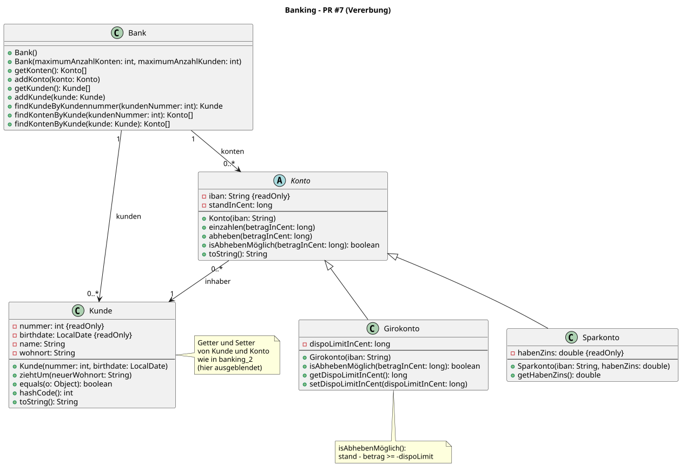

# Java-OO-Einsteigerseminar

Willkommen! Dieses Repository enthält die Beispiele und Lösungen, die wir im
Seminar gemeinsam entwickelt haben. Jeder Schritt ist als eigener Pull Request
nachvollziehbar.

## Was ist drin?

| Ordner | Inhalt |
|--------|--------|
| [`my-first-java`](my-first-java) | Erste Schritte: Wetterstation (Methoden, Arrays), Büro (Stift und Tisch) und Fahrradverleih (Klassen, Objekte, Referenzen, `toString()`, Kapselung) |
| [`my-banking`](my-banking) | Das Banking-Beispiel ohne Build-Werkzeug: Kunden, Konten, Bank – bis zur Vererbung mit Giro- und Sparkonto |
| [`my-banking-maven`](my-banking-maven) | Derselbe Stand als Maven-Projekt (JDK 25) – **damit arbeiten wir weiter** |
| [`docs`](docs) | Klassen- und Objektdiagramme zu jedem Stand |

Zum Starten `my-banking-maven` in der IDE als Maven-Projekt öffnen und
`de.schulung.banking.start.Main` ausführen.

## Diagramme

Die Diagramme liegen in [`docs`](docs) – jeweils als PlantUML-Quelle
(`.plantuml`) und als fertiges Bild (`.svg`). Zum Ansehen genügt das SVG.

| Diagramm | Stand |
|----------|-------|
| [`fahrradverleih_1`](docs/fahrradverleih_1.svg) | PR #1 – Klassen, Felder, Beziehungen |
| [`fahrradverleih_2`](docs/fahrradverleih_2.svg) | PR #2 – `toString()` |
| [`fahrradverleih_3`](docs/fahrradverleih_3.svg) | PR #4 – Kapselung, Konstruktoren, Getter/Setter |
| [`buero_1`](docs/buero_1.svg) | PR #4 – Stift und Tisch, gekapselt |
| [`banking_1`](docs/banking_1.svg) | PR #3 – Konto und Kunde |
| [`banking_2`](docs/banking_2.svg) | PR #4 – Kapselung |
| [`banking_3`](docs/banking_3.svg) | PR #5 – Bank mit Arrays |
| [`banking_4`](docs/banking_4.svg) | PR #6 – Suchen, `equals`/`hashCode` |
| [`banking_5`](docs/banking_5.svg) | PR #7 – Vererbung |
| [`banking_5_objekte`](docs/banking_5_objekte.svg) | Objektdiagramm: welche Objekte es am Ende von `main()` gibt und wie sie verdrahtet sind |



### Diagramme selbst umwandeln

Wer eine `.plantuml`-Datei ändert und daraus ein neues SVG erzeugen möchte,
braucht Java und Node.js. Im Hauptordner des Repositorys:

```bash
npx plantuml-cli -tsvg -charset UTF-8 "docs/banking_5.plantuml"
```

Das SVG entsteht neben der Quelldatei. Für alle Diagramme auf einmal
`"docs/*.plantuml"` angeben.

Ohne Kommandozeile geht es auch: Das IntelliJ-Plugin „PlantUML Integration“
zeigt die Diagramme direkt in der IDE an.
